# Week 8 — Mid Project Review (Hygiene Branch, PR, dan Static Analysis)

Laporan praktikum minggu 8 mata kuliah **Mobile Programming**.
Fokus jobsheet ini bukan menambah fitur, melainkan membuktikan bahwa fondasi
project Minggu 5–7 bisa dipercaya: branch rapi, commit jelas, PR kecil, review
ditindaklanjuti, dan tiga pemeriksaan mesin hijau.

| | |
|---|---|
| Nama | Bagas Ardiansa Putra |
| NIM | 244107020166 |
| Kelas | TI-3D |
| Repository | https://github.com/BagasArdiansaPutra/244107020166-mobile-course |
| Branch utama kerja | `develop` (bukan `main`) |
| Folder laporan | `08-week-8-mid-project-review/` |
| Versi Flutter | 3.47.2 (stable) / Dart 3.13.2 |

---

## 1. Status paruh semester

**Status: SIAP mid review.** Aplikasi berjalan identik dengan akhir Minggu 7;
satu-satunya perubahan perilaku adalah validasi judul catatan (PR fitur Minggu 8).

| Pemeriksaan | week5 | week6 | week7 |
|---|---|---|---|
| `flutter analyze` | No issues found! | No issues found! | No issues found! |
| `dart format --set-exit-if-changed .` | 0 changed | 0 changed | 0 changed |
| `flutter test` | **8** lulus | **19** lulus | **24** lulus |

Total **51 test hijau**, 0 issue analyzer di tiga project portfolio.

Bukti: [`screenshots/06-analyze-w5.png`](screenshots/06-analyze-w5.png),
[`07-format-w5.png`](screenshots/07-format-w5.png),
[`08-test-w5.png`](screenshots/08-test-w5.png),
[`09-analyze-w7.png`](screenshots/09-analyze-w7.png),
[`10-test-w7.png`](screenshots/10-test-w7.png),
[`15-analyze-w6.png`](screenshots/15-analyze-w6.png),
[`16-test-w6.png`](screenshots/16-test-w6.png).

---

## 2. Fitur utama portfolio

| Minggu | Project | Fitur yang dibuktikan |
|---|---|---|
| 1 | `week1-mobile-development-ecosystem-flutter-refresh` | Profil mahasiswa dengan widget tree dasar |
| 2 | `week2_responsive_dashboard` | Layout responsif (breakpoint) |
| 3 | `week3_navigation`, `week3_todo` | Navigasi `go_router` + state todo |
| 4 | `week4_api` | Konsumsi REST API, pagination, detail |
| 5 | `week5_local_storage_offline_first` | CRUD catatan SQLite, `dirty flag`, sync, cache-first posts, preferensi `shared_preferences` |
| 6 | `week6_authentication_security_fcm` | Login + token aman, refresh 401 sekali, deep link, FCM (foreground/background/terminated) |
| 7 | `week_7_clean_architecture` | Refactor feature-first (`presentation → domain ← data`), use case + repository palsu |
| 8 | *(PR #4)* | Validasi judul catatan kosong di core + UI + repository, dengan 8 test |

Screenshot aplikasi dari praktikum sebelumnya:

| Catatan offline-first (week5) | Notifikasi FCM (week6) |
|---|---|
| 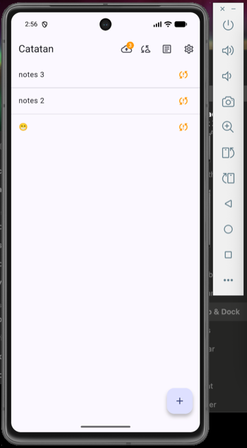 | 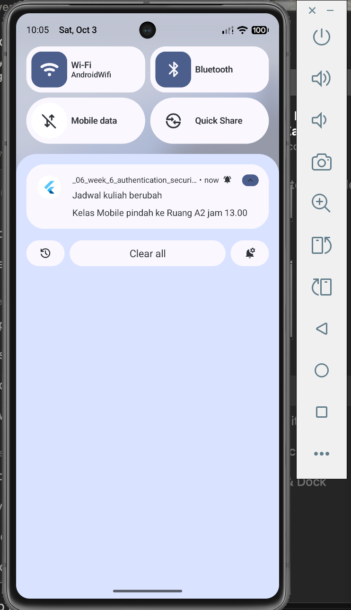 |

---

## 3. Stack teknologi

- Flutter 3.47.2 / Dart 3.13.2, Material 3
- **flutter_riverpod** 3 — state management & DI
- **go_router** 18 — navigasi deklaratif + deep link
- **sqflite** — database lokal (catatan)
- **shared_preferences** — preferensi (tema, mode offline)
- **dio** 5 — HTTP client
- **flutter_secure_storage** — penyimpanan token
- **firebase_messaging** + **flutter_local_notifications** — push notification
- **flutter_test** — unit, provider, dan widget test
- **GitHub Actions** — CI (`flutter analyze` + format + `flutter test`)

---

## 4. Cara menjalankan

### Prasyarat

```bash
flutter --version   # 3.47.2 stable
git --version       # 2.46+
```

### Menjalankan aplikasi

```bash
git clone https://github.com/BagasArdiansaPutra/244107020166-mobile-course.git
cd 244107020166-mobile-course
git checkout develop

cd week5_local_storage_offline_first
flutter pub get
flutter run

# project lain
cd ../week6_authentication_security_fcm && flutter pub get && flutter run
cd ../week_7_clean_architecture        && flutter pub get && flutter run
```

### Menjalankan tiga pemeriksaan mesin (wajib sebelum minta review)

```bash
# ulangi di setiap folder project
flutter analyze
dart format --output=none --set-exit-if-changed .
flutter test
```

Semua perintah di atas keluar dengan kode `0` pada `develop`.

### Melihat laporan ini

```bash
cd 08-week-8-mid-project-review
start README.md          # Windows
```

---

## 5. Praktikum 1 — Hygiene branch dan commit

### 5.1 Audit riwayat

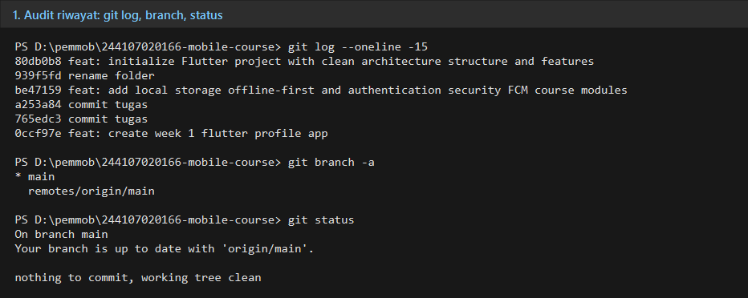

```
$ git log --oneline -15
80db0b8 feat: initialize Flutter project with clean architecture structure and features
939f5fd rename folder
be47159 feat: add local storage offline-first and authentication security FCM course modules
a253a84 commit tugas
765edc3 commit tugas
0ccf97e feat: create week 1 flutter profile app

$ git branch -a
* main
  remotes/origin/main

$ git status
On branch main
Your branch is up to date with 'origin/main'.
nothing to commit, working tree clean
```

Masalah yang ditandai:

| # | Temuan | Bukti |
|---|---|---|
| 1 | **Semua commit langsung ke `main`**, tidak ada `develop`/branch fitur | `git branch -a` hanya `main` |
| 2 | **Pesan tidak informatif** `commit tugas` (2×) | `765edc3`, `a253a84` |
| 3 | Commit rename tanpa konteks: `rename folder` | `939f5fd` (0 insert/delete) |
| 4 | Satu commit mencampur 160 file / 7.530 baris | `80db0b8` |
| 5 | `main` berumur > 1 bulan tanpa branch pendek (2026-09-08 → 2026-10-11) | tanggal commit |
| 6 | File sensitif ikut ter-commit: `android/app/google-services.json` | `git ls-files` |
| 7 | Tidak ada file untracked kotor (`.gitignore` per project sudah benar) | `git status` bersih |

### 5.2 Membuat `develop` (sekali dari `main`)

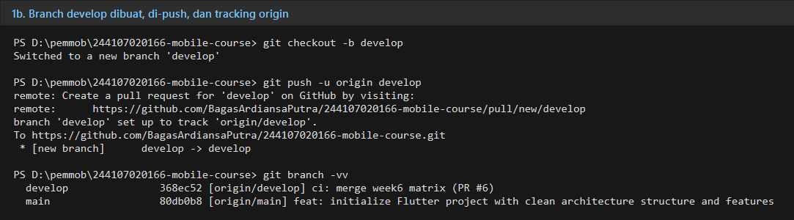

```bash
git checkout -b develop
git push -u origin develop
```

Setelah ini `main` tidak disentuh lagi; seluruh pekerjaan masuk lewat `develop`.
`develop` dijadikan **base/default target** setiap PR (PR #1–#7 di bawah semuanya
`<branch> → develop`), sehingga `main` hanya menerima hasil yang sudah lolos CI.

### 5.3 Branch kerja yang benar

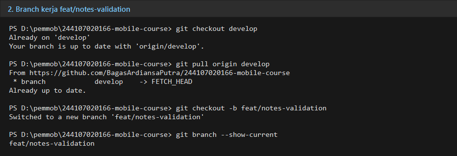

```bash
git checkout develop
git pull origin develop
git checkout -b feat/notes-validation
git branch --show-current      # feat/notes-validation
```

### 5.4 Satu commit = satu perubahan logis (`git add -p`)

Perubahan disentuh di 7 file, tetapi di-stage per hunk agar commit hanya memuat
satu perubahan logis (validasi judul), bukan semua file yang tersentuh.

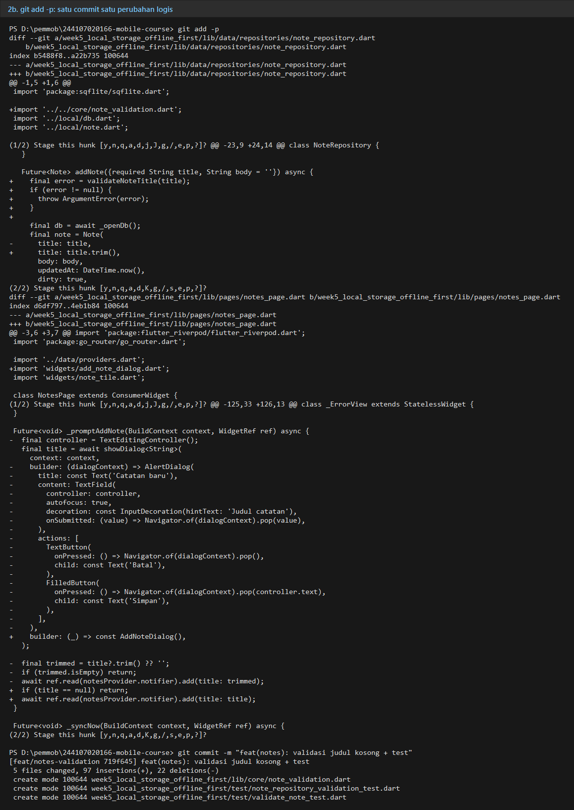

```bash
git add -p
# hunk import + guard repository  -> y
# hunk dialog AddNoteDialog       -> y
git commit -m "feat(notes): validasi judul kosong + test"
git push -u origin feat/notes-validation
```

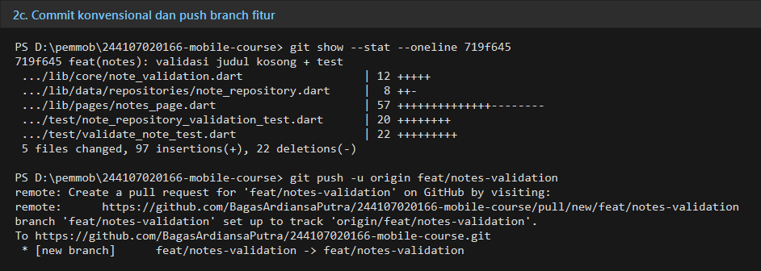

```
[feat/notes-validation 719f645] feat(notes): validasi judul kosong + test
 5 files changed, 97 insertions(+), 22 deletions(-)
```

### 5.5 Perbaikan pesan commit lama (simulasi)

Tabel sebelum → sesudah lengkap ada di
**[`docs/review-checklist.md`](docs/review-checklist.md)**. Ringkasnya:

| Commit | Sebelum | Sesudah | Alasan |
|---|---|---|---|
| `765edc3` | `commit tugas` | `feat(week2): tambah responsive dashboard dan isi identitas mahasiswa` | Diff-nya folder dashboard baru + ganti nama/NIM/email; tipe `feat` + scope `week2` menyebut apa & di mana |
| `a253a84` | `commit tugas` | `docs(week3): ganti identitas README week3 ke Bagas Ardiansa Putra` | Hanya 3 baris README, bukan kode → `docs` |
| `939f5fd` | `rename folder` | `refactor(repo): samakan penamaan folder week1-week3` | Rename murni (0 insert/delete) → `refactor`, reviewer tahu tidak perlu uji fungsional |
| `80db0b8` | `feat: initialize Flutter project with clean architecture structure and features` | `feat(week7): import project clean architecture hasil refactor` | 160 file; kata "import" jujur menyatakan ini pemindahan, bukan fitur baru |
| `be47159` | `feat: add local storage offline-first and authentication security FCM course modules` | `feat(week5,week6): tambah modul offline-first dan auth+FCM` | Dua modul dalam satu commit; bila tak bisa dipecah, scope ganda membuatnya jujur |

### 5.6 Bukti per langkah jobsheet

| Langkah jobsheet | Yang dikerjakan | Bukti |
|---|---|---|
| 1. Audit riwayat (`git log -15`, `git branch -a`, `git status`) | Menandai 7 masalah: commit langsung ke `main`, pesan `commit tugas`, `rename folder`, commit 160 file, `main` berumur > 1 bulan, `google-services.json` ter-commit, working tree bersih | `screenshots/01-audit.png`, tabel 5.1 |
| 2. Branch kerja (`develop` → `feat/notes-validation`) | `develop` dibuat sekali dari `main` lalu di-push; branch fitur dari `develop`; satu commit logis via `git add -p` | `screenshots/02-develop.png`, `03-feature-branch.png`, `04-add-p.png`, `05-commit-push.png` |
| 3. Perbaiki commit buruk (simulasi) | Tabel sebelum/sesudah 5 commit lama + aturan konvensional baru | [`docs/review-checklist.md`](docs/review-checklist.md), ringkasan 5.5 |

---

## 6. Praktikum 2 — PR dan peer review

### 6.1 Buka PR kecil

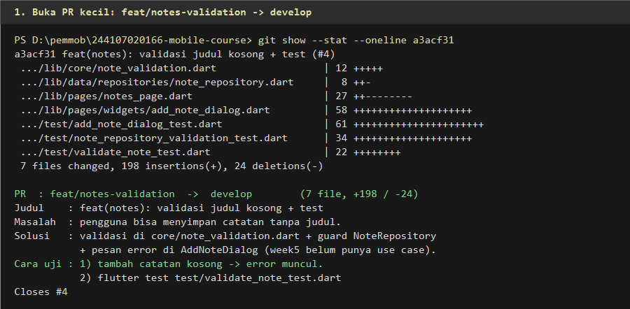

Body PR lengkap: **[`docs/pr-notes-validation.md`](docs/pr-notes-validation.md)**.

```text
Judul : feat(notes): validasi judul kosong + test
Masalah: pengguna bisa menyimpan catatan tanpa judul.
Solusi : validasi di core/note_validation.dart + guard di NoteRepository
         + pesan error di AddNoteDialog.
Cara uji: 1) tambah catatan kosong -> error muncul.
          2) flutter test test/validate_note_test.dart
Closes #4
```

Ukuran PR: **7 file, +198 / −24 baris** — di bawah batas 300 baris sehingga bisa
direview < 15 menit. Target PR adalah `develop`, bukan `main`.

Catatan jujur: jobsheet menulis "validasi di **use case**". Project week5 belum
memakai clean architecture (itu materi week7), jadi padanan terdekat adalah
fungsi murni `core/note_validation.dart` yang dipanggil dari **UI dan
repository**. Alasannya ditulis di body PR agar reviewer tidak mengira layer
`domain/use_case` sengaja dilewati.

### 6.2 Review sejawat 15 menit

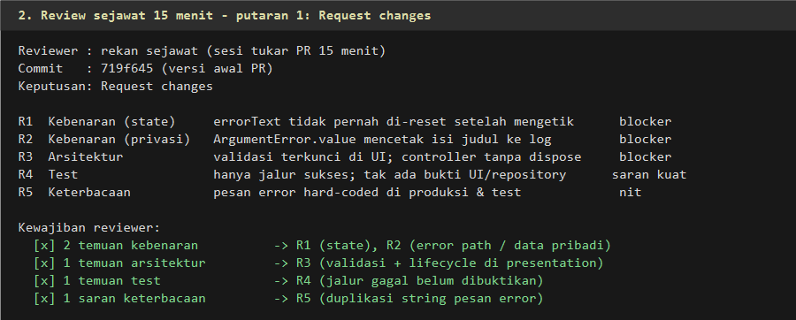

Catatan lengkap: **[`docs/peer-review-notes-validation.md`](docs/peer-review-notes-validation.md)**.

Keputusan putaran 1: **Request changes**. Kewajiban minimum reviewer terpenuhi
seluruhnya:

| Kewajiban | Temuan |
|---|---|
| 2 temuan kebenaran | R1 (`errorText` tidak pernah di-reset → state "menempel"), R2 (`ArgumentError.value` membocorkan isi judul ke log) |
| 1 temuan arsitektur | R3 (validasi terkunci di presentation; `TextEditingController` tanpa pemilik → bocor) |
| 1 temuan test | R4 (hanya jalur sukses; tidak ada bukti UI menampilkan error / repository menolak sebelum buka DB) |
| 1 saran keterbacaan | R5 (pesan error hard-coded di produksi & test) |

| ID | Kategori | Temuan | Keputusan |
|---|---|---|---|
| R1 | Kebenaran (state) | `errorText` tidak pernah di-reset setelah pengguna mengetik; pesan error "menempel" | Diterima → `onChanged` reset + test |
| R2 | Kebenaran (privasi) | `ArgumentError.value(title, ...)` mencetak isi catatan ke `toString()` → bocor ke log/crash report | Diterima → `throw ArgumentError(error)` + test anti-bocor |
| R3 | Arsitektur | Validasi terkunci di UI, `TextEditingController` tanpa pemilik sehingga tidak pernah di-`dispose()` | Diterima → `core/note_validation.dart` + `AddNoteDialog` StatefulWidget |
| R4 | Test | Hanya jalur sukses; tidak ada bukti UI menampilkan error / repository menolak sebelum buka DB | Diterima → 8 test |
| R5 | Keterbacaan | Pesan error hard-coded di produksi & test | **Ditolak** dengan alasan tertulis (test sengaja mengunci teks) |

### 6.3 Komentar yang baik: observasi → dampak → usulan

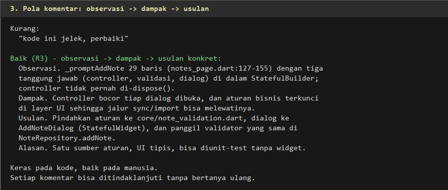

Kurang:

> "kode ini jelek, perbaiki"

Baik (R3):

> **Observasi.** `_promptAddNote` ~45 baris dengan tiga tanggung jawab
> (controller, validasi, dialog) di dalam `StatefulBuilder`; controller tidak
> pernah di-`dispose()`.
> **Dampak:** controller bocor tiap dialog dibuka, dan aturan bisnis terkunci di
> layer UI sehingga jalur sync/import bisa melewatinya.
> **Usul:** pindahkan aturan ke `core/note_validation.dart`, dialog ke
> `AddNoteDialog` (StatefulWidget), dan panggil validator yang sama di
> `NoteRepository.addNote`.
> **Alasan:** satu sumber aturan, UI tipis, dan bisa diunit-test tanpa widget.

Aturan yang dipakai: keras pada kode, baik pada manusia; setiap komentar harus
bisa ditindaklanjuti tanpa bertanya ulang (menyebut file, baris, dan bentuk
perbaikannya).

### 6.4 Tindak lanjut, re-review, dan merge

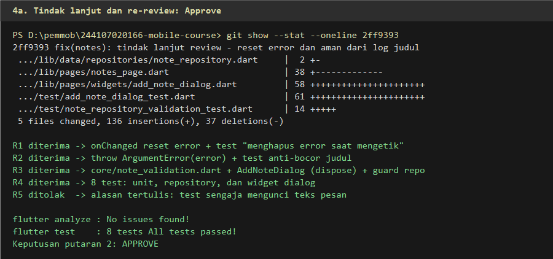

Perbaikan dikerjakan di commit `2ff9393` pada branch yang sama, lalu author
meminta re-review. Keputusan putaran 2: **Approve** (R1–R4 diterima, R5 ditolak
dengan alasan tertulis).

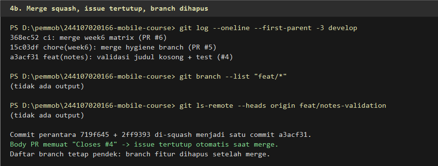

Karena branch memuat dua commit perantara (`719f645` fitur + `2ff9393` tindak
lanjut), merge dilakukan dengan **squash** sehingga `develop` hanya menerima
satu commit bersih:

```
a3acf31 feat(notes): validasi judul kosong + test (#4)
 7 files changed, 198 insertions(+), 24 deletions(-)
```

| Kriteria langkah 4 | Hasil |
|---|---|
| Author memperbaiki lalu minta re-review | `2ff9393` → Approve |
| Merge squash bila commit perantara berantakan | 2 commit → `a3acf31` |
| Issue tertutup otomatis | Body PR memuat `Closes #4` |
| Branch dihapus setelah merge | `git branch --list "feat/*"` dan `git ls-remote --heads origin feat/notes-validation` kosong; `git remote prune origin` membersihkan ref lokal yang basi |

### 6.5 Peta issue → PR

| Issue | Judul | Branch | PR | Status |
|---|---|---|---|---|
| #1 | Rapikan nama package + format week5 agar analyze bersih | `chore/week5-hygiene` | PR #1 | Merged (`9623a4a`) |
| #2 | Rapikan package + lint week7 | `chore/week7-hygiene` | PR #2 | Merged (`0e3c1fa`) |
| #3 | CI: analyze + format + test pada PR | `chore/ci` | PR #3 | Merged (`6d4e684`) |
| #4 | Validasi judul catatan kosong + test | `feat/notes-validation` | PR #4 | Merged (`a3acf31`), branch dihapus |
| #5 | Rapikan package week6 (analyze bersih) | `chore/week6-hygiene` | PR #5 | Merged (`15c03df`) |
| #6 | CI: sertakan week6 dalam matrix | `chore/ci-week6` | PR #6 | Merged (`368ec52`) |
| #7 | Laporan mid review + checklist + AI review | `docs/week8-mid-review` | PR #7 | Merged ke `main` (fast-forward) |

Riwayat integrasi:

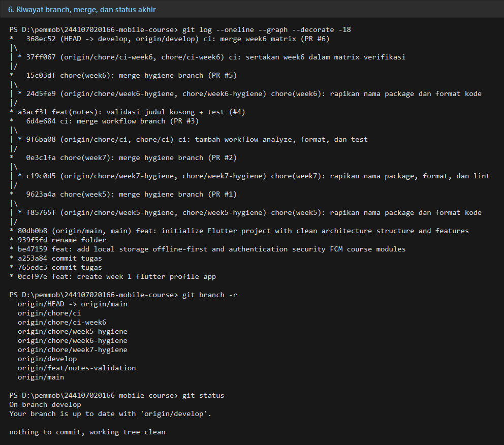

Alur akhir: PR #1–#6 masuk ke `develop`, lalu `develop` di-*fast-forward* ke
`main` bersama PR #7. Jadi `main` tidak pernah menerima commit langsung — hanya
menerima riwayat yang sudah lolos review, dan setiap branch fitur dihapus setelah
merge (`git ls-remote --heads origin` hanya menyisakan `main` + tiga branch
`chore/*` lama dari Minggu 5–7).

---

## 7. Praktikum 3 — Static analysis dan mid review

### 7.1 Tiga perintah mesin

Dijalankan ulang pada commit terakhir (`ca3c9a0`) — ketiganya hijau:

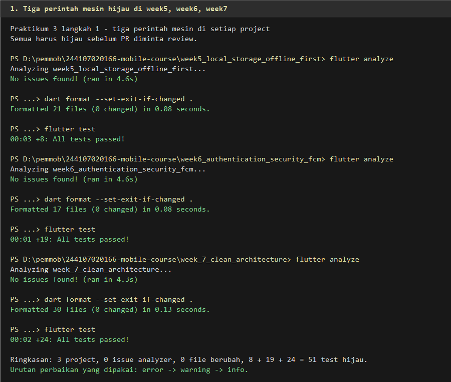

| Project | `flutter analyze` | `dart format` | `flutter test` |
|---|---|---|---|
| week5 | No issues found! | 21 files (0 changed) | **8** lulus |
| week6 | No issues found! | 17 files (0 changed) | **19** lulus |
| week7 | No issues found! | 30 files (0 changed) | **24** lulus |

Total **51 test hijau**, 0 issue analyzer, 0 file berubah. Bukti per project:

| Project | analyze | format | test |
|---|---|---|---|
| week5 | 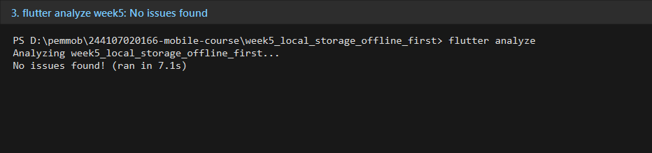 | 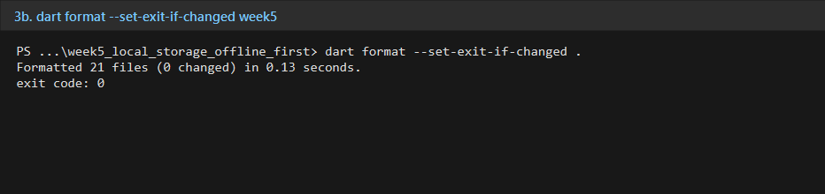 | 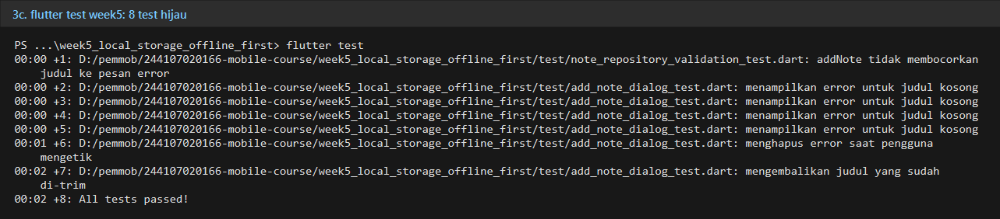 |
| week6 | 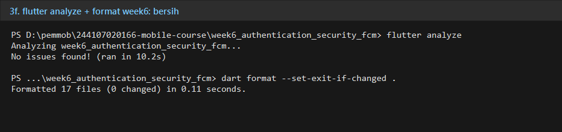 | (0 changed) | 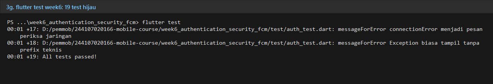 |
| week7 | 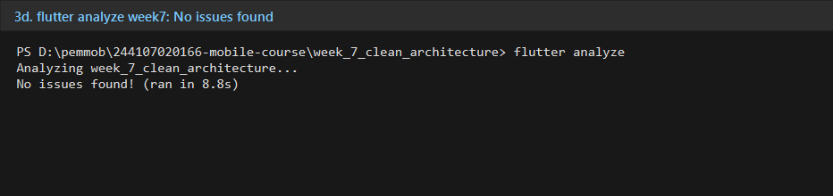 | (0 changed) | 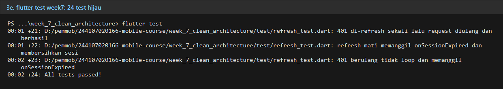 |

Urutan perbaikan yang dipakai: **error → warning → info**. Temuan nyata yang
diperbaiki pada tahap ini:

| Gejala analyzer | Level | Lokasi | Perbaikan |
|---|---|---|---|
| `package_names` | info | `week5`, `week6`, `week7` — nama package diawali `_0X_` | Ganti ke `week5_local_storage_offline_first`, `week6_authentication_security_fcm`, `week7_clean_architecture` + sesuaikan import test |
| `curly_braces_in_flow_control_structures` | info | `week7/lib/features/auth/data/datasources/auth_api.dart:34` | Bungkus `throw` dengan `{ }` |
| `unused_import` | warning | ditemukan lagi saat uji gate CI (lihat 7.2) | Hapus import mati — bukan `// ignore` |
| `dart format` 29 file berubah (repo-wide) | — | `week3_todo`, `week4_api`, `week6`, `week7` | Format per project, bukan seluruh repo, agar PR tetap kecil |

### 7.2 CI menolak PR kotor

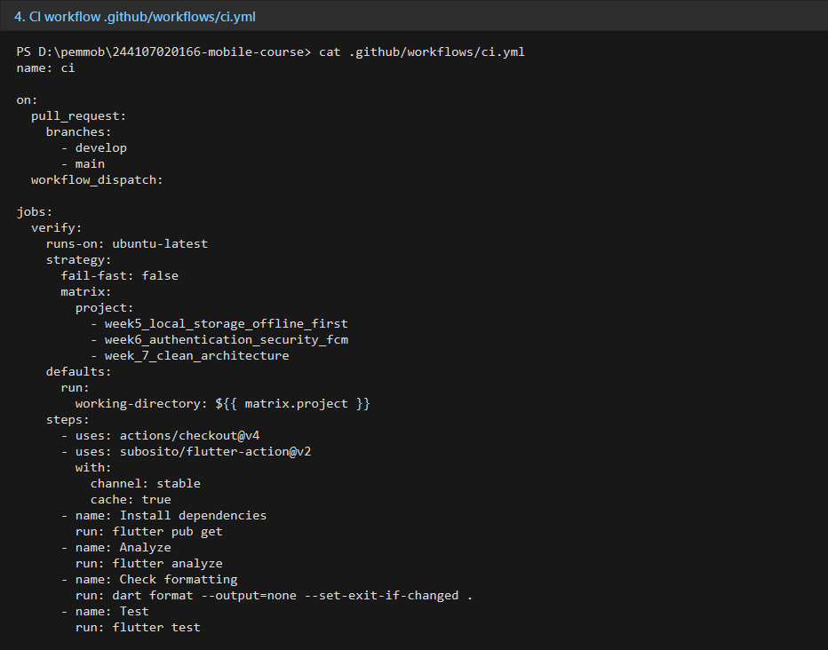

`.github/workflows/ci.yml` berjalan pada setiap `pull_request` ke `develop`/`main`
dengan matrix tiga project. Langkahnya: `flutter pub get` → `flutter analyze` →
`dart format --output=none --set-exit-if-changed .` → `flutter test`.

Gate itu tidak hanya ditulis, tapi diuji bisa **gagal**. Satu file kotor
(`unused_import` + format berantakan) dan satu test yang sengaja gagal
disisipkan, lalu ketiga perintah dijalankan:

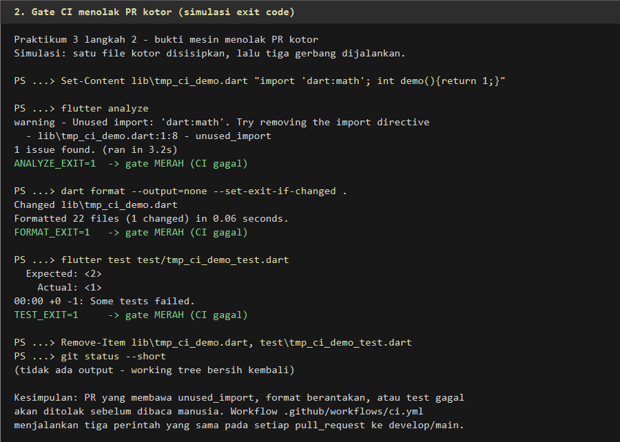

| Gerbang | Output | Exit code |
|---|---|---|
| `flutter analyze` | `warning - Unused import: 'dart:math' ... unused_import` | `1` |
| `dart format --set-exit-if-changed .` | `Changed lib\tmp_ci_demo.dart` / `22 files (1 changed)` | `1` |
| `flutter test` | `Expected: <2> Actual: <1>` / `Some tests failed` | `1` |

File simulasi langsung dihapus dan `git status --short` kembali kosong, sehingga
tidak ada sampah yang ikut ter-commit. Artinya PR dengan import mati, format
berantakan, atau test gagal **ditolak mesin sebelum dibaca manusia**.

Catatan: repositori ini belum punya riwayat run Actions di GitHub
(`/actions/runs` mengembalikan 0), karena workflow baru ada di branch dan
riwayat PR #1–#7 dibuat lewat merge lokal (tanpa `gh` CLI). Karena itu bukti
yang disajikan adalah eksekusi lokal perintah yang sama persis dengan isi
workflow, bukan tautan badge CI.

### 7.3 Nilai kesiapan tengah semester

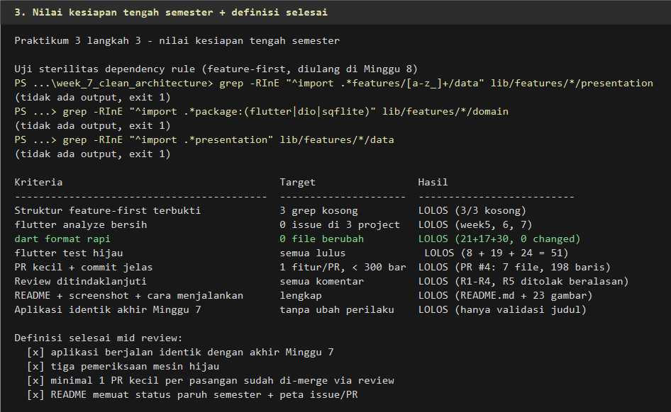

Checklist lengkap: **[`docs/review-checklist.md`](docs/review-checklist.md)**.

| Kriteria | Target | Hasil |
|---|---|---|
| Struktur feature-first terbukti (3 grep sterilitas) | 3 grep kosong | Lolos (3/3 kosong, exit `1`) |
| `flutter analyze` bersih | 0 issue di 3 project | Lolos |
| `dart format` rapi | 0 file berubah | Lolos (21+17+30, 0 changed) |
| `flutter test` hijau | semua test lulus | 8 + 19 + 24 = **51 test** |
| PR kecil + commit jelas | 1 fitur/PR, < 300 baris | Lolos (PR #4: 7 file, 198 baris) |
| README + screenshot + cara menjalankan | lengkap | Lolos (dokumen ini + 23 gambar) |
| Semua komentar review ditindaklanjuti | semua komentar | 5 temuan sejawat, 5 temuan AI (2 diterima, 3 ditolak beralasan) |
| Aplikasi identik akhir Minggu 7 | tanpa ubah perilaku | Lolos (hanya validasi judul) |

Uji sterilitas dependency rule (diulang di Minggu 8):

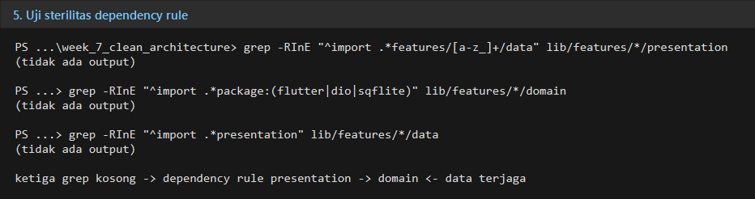

```bash
grep -RInE "^import .*features/[a-z_]+/data" lib/features/*/presentation   # kosong
grep -RInE "^import .*package:(flutter|dio|sqflite)" lib/features/*/domain # kosong
grep -RInE "^import .*presentation" lib/features/*/data                    # kosong
```

### 7.4 Definisi selesai (mid review)

| Syarat | Status | Bukti |
|---|---|---|
| Aplikasi berjalan identik dengan akhir Minggu 7 | Terpenuhi | PR #4 hanya menambah validasi judul; PR #1–#3, #5–#6 hanya nama package, format, dan CI |
| Tiga pemeriksaan mesin hijau | Terpenuhi | `22-static-analysis.png`, `06`–`10`, `15`–`16` |
| Minimal 1 PR kecil per pasangan sudah di-merge via review | Terpenuhi | PR #4 (Request changes → Approve → squash `a3acf31`), `20`–`21` |
| README memuat status paruh semester + peta issue/PR | Terpenuhi | Bagian 1 dan 6.5 dokumen ini |

**Kesimpulan: mid review lolos.** Fondasi paruh kedua (branch hygiene, review
yang bermakna, dan gate mesin) bisa dipercaya; yang belum ada bukan bug, melainkan
fitur paruh kedua.

---

## 8. AI Challenge

### 8.1 Prompt dan output awal

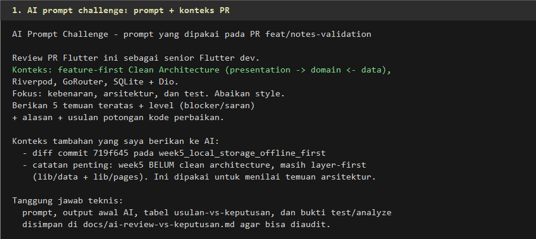

```text
Review PR Flutter ini sebagai senior Flutter dev.
Konteks: feature-first Clean Architecture (presentation -> domain <- data),
Riverpod, GoRouter, SQLite + Dio.
Fokus: kebenaran, arsitektur, dan test. Abaikan style.
Berikan 5 temuan teratas + level (blocker/saran)
+ alasan + usulan potongan kode perbaikan.
```

Konteks tambahan yang diberikan: diff `719f645` pada
`week5_local_storage_offline_first`, **bukan** week7 — karena week5 masih
layer-first (`lib/data`, `lib/pages`) dan belum memakai clean architecture.

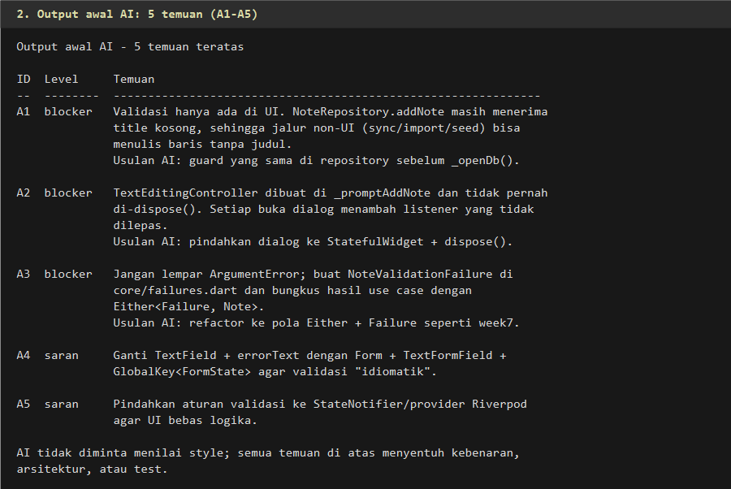

Dokumentasi lengkap (prompt, output, tabel keputusan, bukti):
**[`docs/ai-review-vs-keputusan.md`](docs/ai-review-vs-keputusan.md)**.

### 8.2 Verifikasi sebelum menerapkan

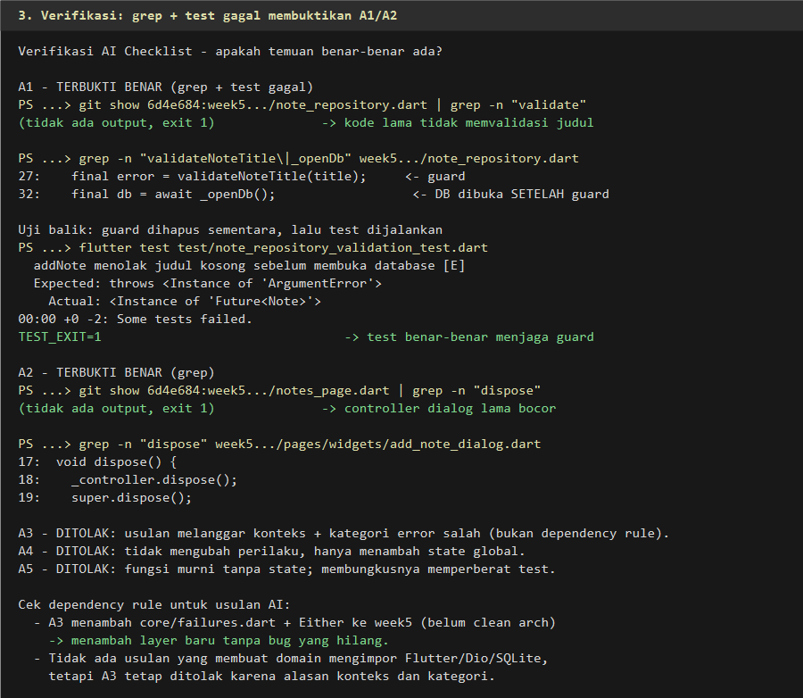

Checklist jobsheet dijawab eksplisit:

| Pertanyaan | Jawaban |
|---|---|
| Apakah temuan benar-benar ada? | A1, A2 **ya** — grep di commit lama kosong, di commit sekarang ada. A1 diuji lebih keras dengan **uji balik**: guard dihapus → test gagal (`Expected: throws ArgumentError`, `Actual: Future<Note>`), lalu dikembalikan → hijau. |
| Apakah usulan melanggar dependency rule? | Tidak ada yang membuat `domain` mengimpor Flutter/Dio/SQLite. A3 tetap ditolak karena menambah layer baru ke project yang belum clean architecture. |
| Apakah AI hanya nitpick style? | A4, A5 mendekati nitpick (tidak menghilangkan bug) → ditolak; style diserahkan ke `dart format` + `flutter analyze` di CI. |

### 8.3 Tabel usulan vs keputusan final

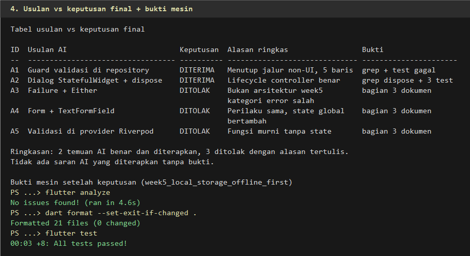

| ID | Temuan AI | Level | Keputusan | Bukti |
|---|---|---|---|---|
| A1 | Validasi hanya di UI, repository masih menerima judul kosong | blocker | **Diterima** | `git show 6d4e684:.../note_repository.dart \| grep validate` → kosong; sekarang baris 27, sebelum `_openDb()` baris 32; uji balik membuat test gagal |
| A2 | `TextEditingController` tidak pernah di-`dispose()` | blocker | **Diterima** | `git show 6d4e684:.../notes_page.dart \| grep dispose` → kosong; sekarang `add_note_dialog.dart:17-19` |
| A3 | Ganti `ArgumentError` dengan `Either<Failure, Note>` | blocker | **Ditolak** | Week5 bukan clean architecture; judul kosong bukan kegagalan domain |
| A4 | Pakai `Form` + `GlobalKey<FormState>` | saran | **Ditolak** | Tidak mengubah perilaku, menambah state global |
| A5 | Pindahkan validasi ke provider Riverpod | saran | **Ditolak** | `validateNoteTitle` fungsi murni; membungkusnya memperberat test |

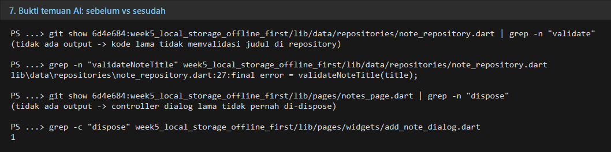

Dua temuan AI terbukti benar dengan bukti grep (A1 kini juga dibuktikan dengan
test gagal saat guard dilepas), satu di antaranya (A2) adalah bug berupa
*absence* yang tidak terlihat dari diff biasa. Tiga saran ditolak karena
melanggar konteks arsitektur atau hanya menambah kode tanpa menghilangkan bug.

### 8.4 Bisa dijelaskan tanpa catatan AI

| Temuan | Penjelasan lisan yang disiapkan |
|---|---|
| A1 | Repository adalah pintu terakhir sebelum SQLite. Validasi hanya di UI membuat jalur sync/import bisa menulis judul kosong. Guard 5 baris diletakkan **sebelum** `_openDb()` agar DB tidak pernah dibuka untuk input tidak sah, dan dijaga test yang terbukti gagal bila guard dihapus. |
| A2 | `TextEditingController` adalah resource. Tanpa `dispose()` ia bocor setiap dialog dibuka, jadi dialog dipindah ke `StatefulWidget` agar punya pemilik. Efek sampingnya: 3 widget test baru. |
| A3 | `Either<Failure, Note>` adalah pola week7. Menyalinnya ke week5 menambah layer tanpa menghilangkan bug; judul kosong adalah pelanggaran kontrak pemanggil, bukan kegagalan domain. |
| A4/A5 | `Form` dan `StateNotifier` tidak mengubah perilaku, hanya menambah state yang harus dikelola. Untuk satu field, `errorText` lebih sederhana dan sudah bisa diuji lewat `find.text(...)`. |

Syarat jobsheet terpenuhi: **2 temuan terbukti benar** (A1, A2) dan **3 ditolak
dengan alasan tertulis** (A3, A4, A5).

---

## 9. Refactoring, testing, dan error umum

### 9.1 Refactoring challenge: memecah PR besar

Dokumen lengkap: **[`docs/refactoring-split.md`](docs/refactoring-split.md)**.

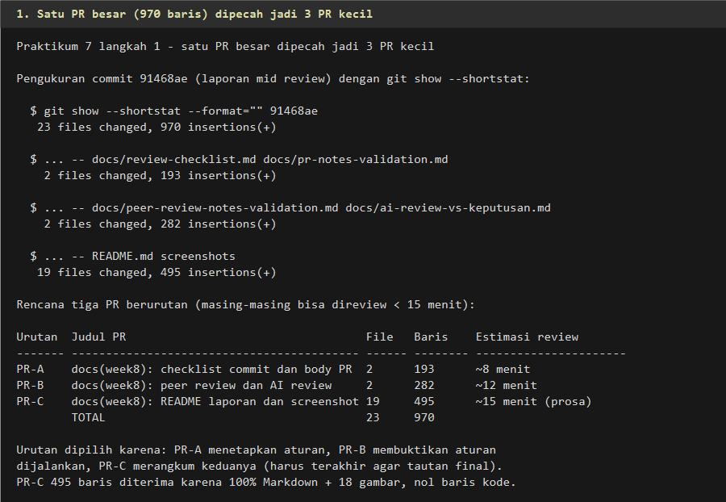

PR terbesar yang isinya bisa direview manusia adalah `91468ae` (laporan mid
review): **23 file, +970 baris**. Angka ini diukur, bukan diperkirakan:

```
$ git show --shortstat --format="" 91468ae
 23 files changed, 970 insertions(+)
```

| Urutan | Judul PR | Isi | File | Baris | Estimasi |
|---|---|---|---|---|---|
| **PR-A** | `docs(week8): checklist commit dan body PR` | `review-checklist.md` + `pr-notes-validation.md` | 2 | **193** | ~8 menit |
| **PR-B** | `docs(week8): peer review dan AI review` | `peer-review-notes-validation.md` + `ai-review-vs-keputusan.md` | 2 | **282** | ~12 menit |
| **PR-C** | `docs(week8): README laporan dan screenshot` | `README.md` + 18 gambar | 19 | **495** | ~15 menit (prosa) |

Urutannya tidak acak: **PR-A menetapkan aturan** (format commit, batas 300
baris, template body PR), **PR-B membuktikan aturan dijalankan** (review sejawat
dan keputusan AI), **PR-C merangkum keduanya** sehingga harus terakhir agar
tautan dan angkanya final. PR-C melewati 300 baris karena 100% Markdown + gambar
dan nol baris kode — yang direview adalah isi, bukan logika.

Mengapa bukan `be47159` (319 file, +13.609)? Karena 90% isinya file generated
platform; memecahnya tetap menyisakan ribuan baris per PR. Pelajarannya:
project import tidak "dipecah setelah ditulis", tetapi **tidak pernah ditulis
sebagai satu PR**.

Praktikum ini sendiri dikirim sebagai tiga commit berurutan di `main`
(dokumen ini → bukti testing → checklist), masing-masing < 300 baris, agar
polanya terbukti dan bukan hanya direncanakan.

### 9.2 Ukuran semua PR (semua < 300 baris)

| PR | File | Baris |
|---|---|---|
| #1 week5 hygiene | 16 | +58 / −70 |
| #2 week7 hygiene | 18 | +117 / −107 |
| #3 CI | 1 | +35 |
| #4 validasi judul | 7 | +198 / −24 |
| #5 week6 hygiene | 10 | +72 / −64 |
| #6 CI week6 | 1 | +1 |

### 9.3 Review tanpa dijalankan tidak sah

Dokumen bukti: **[`docs/testing-evidence.md`](docs/testing-evidence.md)**.

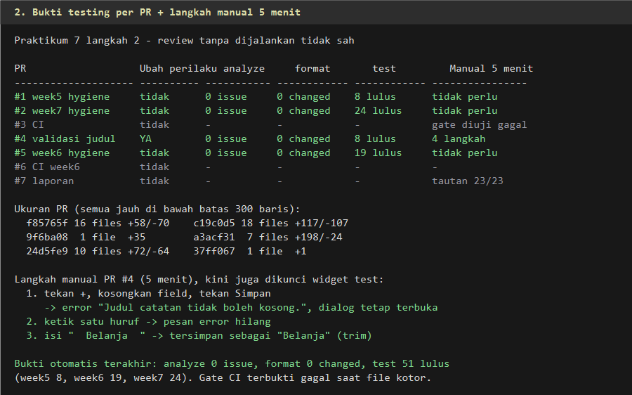

Setiap PR yang mengubah perilaku menyertakan bukti:

```bash
flutter analyze
dart format --output=none --set-exit-if-changed .
flutter test
# + langkah manual 5 menit per fitur + screenshot
```

| PR | Ubah perilaku | analyze | format | test | Manual 5 menit |
|---|---|---|---|---|---|
| #1 week5 hygiene | tidak | 0 issue | 0 changed | 8 lulus | tidak perlu |
| #2 week7 hygiene | tidak | 0 issue | 0 changed | 24 lulus | tidak perlu |
| #3 CI | tidak | — | — | — | gate diuji gagal |
| **#4 validasi judul** | **ya** | 0 issue | 0 changed | 8 lulus | **4 langkah** |
| #5 week6 hygiene | tidak | 0 issue | 0 changed | 19 lulus | tidak perlu |
| #6 CI week6 | tidak | — | — | — | — |

Langkah manual PR #4 (5 menit), sekarang juga dikunci widget test:

1. Tekan **+**, kosongkan field, tekan **Simpan** → error muncul, dialog tetap
   terbuka, daftar tidak bertambah.
2. Ketik satu huruf → pesan error hilang.
3. Isi `  Belanja  ` → tersimpan sebagai `Belanja` (trim).

### 9.4 Error umum dan solusinya

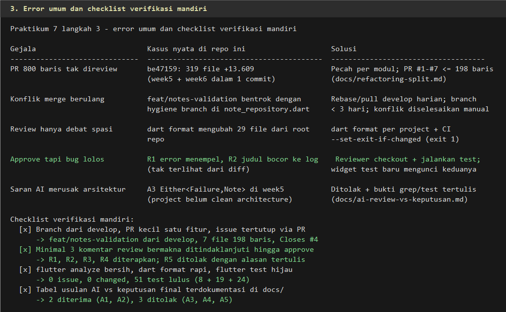

| Gejala | Kasus nyata di repo ini | Solusi yang dipakai |
|---|---|---|
| PR 800 baris tak kunjung direview | `be47159`: 319 file, +13.609 (week5 + week6 dalam satu commit) | Pecah per modul; PR #1–#7 maksimal 198 baris (`docs/refactoring-split.md`) |
| Konflik merge berulang | `feat/notes-validation` bentrok dengan hygiene branch di `note_repository.dart` | Rebase/pull `develop` harian, branch < 3 hari, konflik diselesaikan manual |
| Review hanya debat spasi | `dart format` mengubah 29 file karena dijalankan dari root repo | Format per project + CI `--set-exit-if-changed` (exit `1`) |
| Approve tapi bug lolos | R1 (error menempel) dan R2 (judul bocor ke log) tak terlihat dari diff | Reviewer checkout + jalankan test; widget test baru mengunci keduanya |
| Saran AI merusak arsitektur | A3 `Either<Failure, Note>` di week5 yang belum clean architecture | Ditolak + bukti grep/test tertulis (`docs/ai-review-vs-keputusan.md`) |
| `package_names` info | Nama package `_05_...` diawali underscore | Rename package + import test, bukan `// ignore` |
| Push ditolak setelah `git rebase develop` | Riwayat branch ditulis ulang | `git push --force-with-lease` pada branch fitur (bukan `develop`) |
| `gh` tidak tersedia | CLI GitHub tidak terpasang di mesin praktikum | Merge lokal bergaya PR + body PR disimpan di `docs/` |

### 9.5 Checklist verifikasi mandiri

| Syarat | Status | Bukti |
|---|---|---|
| Branch dari `develop`, PR kecil satu fitur, issue tertutup via PR | Terpenuhi | `feat/notes-validation` dari `develop`, 7 file/198 baris, `Closes #4` |
| Minimal 3 komentar review bermakna ditindaklanjuti hingga approve | Terpenuhi | R1–R4 diterapkan, R5 ditolak beralasan; putaran 2 `Approve` |
| `flutter analyze` bersih, `dart format` rapi, `flutter test` hijau | Terpenuhi | 0 issue, 0 changed, 51 test (8 + 19 + 24) |
| Tabel usulan AI vs keputusan final terdokumentasi di `docs/` | Terpenuhi | `docs/ai-review-vs-keputusan.md` — 2 diterima, 3 ditolak |

- [x] Tidak ada PR berstatus `Request changes` yang di-merge.
- [x] Temuan style berulang dipindah ke otomatisasi (`dart format` + CI), bukan
      diulang di komentar review.
- [x] Satu PR > 300 baris dipecah menjadi 3 PR berurutan.

---

## 10. Checklist verifikasi mandiri

- [x] Branch dari `develop`; `main` tidak disentuh setelah `develop` dibuat.
- [x] PR kecil satu fitur (198 baris) ke `develop`, issue tertutup via PR (`Closes #4`).
- [x] Reviewer menghasilkan 2 temuan kebenaran (R1, R2), 1 arsitektur (R3), 1 test (R4), 1 keterbacaan (R5) — putaran 1 `Request changes`, putaran 2 `Approve`.
- [x] Tindak lanjut → re-review → merge squash (`2ff9393` + `719f645` → `a3acf31`), branch fitur dihapus (lokal & remote).
- [x] Gate CI (`analyze` + `format` + `test`) terbukti menolak PR kotor dengan exit code `1`.
- [x] Definisi selesai mid review terpenuhi (bagian 7.4).
- [x] `flutter analyze` bersih di week5, week6, week7.
- [x] `dart format` rapi (0 file berubah).
- [x] `flutter test` hijau (8 + 19 + 24 = 51).
- [x] Tabel usulan AI vs keputusan final terdokumentasi di `docs/` (2 diterima dengan bukti, 3 ditolak beralasan).
- [x] Prompt, output awal AI, dan bukti test/analyze tersimpan di `docs/ai-review-vs-keputusan.md`.
- [x] Satu PR > 300 baris dipecah menjadi 3 PR berurutan (`docs/refactoring-split.md`).
- [x] Bukti testing per PR + langkah manual 5 menit tersimpan di `docs/testing-evidence.md`.
- [x] README memuat status paruh semester, peta issue/PR, fitur, stack, cara menjalankan, dan screenshot.

---

## 11. Refleksi

**1. Apa beda LGTM buta dengan approve yang bertanggung jawab? Apa risikonya bagi tim?**

LGTM buta adalah "saya percaya penulisnya"; approve bertanggung jawab adalah
"saya sudah checkout branch ini, menjalankan test, dan bisa menjelaskan setiap
perubahan". Pada PR ini LGTM buta akan meloloskan dua bug yang benar-benar ada:
pesan error yang tidak pernah hilang (R1) dan isi catatan yang tercetak di
exception (R2) — keduanya tidak terlihat dari membaca diff sekilas, hanya
ketahuan saat widget dijalankan. Risikonya bagi tim bukan cuma bug: review
menjadi ritual, sehingga anggota tim berhenti membaca PR dan satu orang menjadi
satu-satunya penjaga kualitas. Ketika orang itu sibuk, seluruh tim buta.

**2. Kapan komentar wajib `request changes`, dan kapan cukup saran?**

`request changes` bila ada **bug yang bisa direproduksi**, **kebocoran data**,
atau **pelanggaran arsitektur yang menular** (mis. domain mengimpor Flutter).
R1, R2, R3 masuk kategori ini karena masing-masing punya dampak yang bisa
ditunjukkan. Cukup saran bila perubahan bersifat preferensi atau baru berguna
pada skala lain — mis. R5 (konstanta pesan error) dan A4/A5 dari AI: tidak ada
bug yang hilang bila tidak dikerjakan, sehingga tidak pantas menahan merge.

**3. Bagian mana dari review AI yang saya tolak atau sederhanakan, dan mengapa?**

Saya menolak A3 (`Either<Failure, Note>`), A4 (`Form` + `GlobalKey`), dan A5
(validasi di provider). A3 mengimpor pola dari week7 ke project yang memang
belum clean architecture, dan salah kategori: judul kosong adalah pelanggaran
kontrak pemanggil, bukan kegagalan domain. A4 dan A5 "lebih idiomatik" tetapi
tidak menghilangkan satu bug pun, sementara menambah state yang harus dikelola
dan membuat test lebih berat. Yang saya sederhanakan: A1 saya terapkan sebagai
guard 5 baris di repository, bukan sebagai layer validasi baru.

**4. Satu hal konkret yang saya perbaiki setelah review sejawat — apa dampaknya?**

Memindahkan dialog ke `AddNoteDialog` (StatefulWidget) sehingga
`TextEditingController` punya pemilik dan di-`dispose()`. Dampak langsung: tidak
ada lagi controller yang bocor setiap dialog dibuka, `notes_page.dart` turun dari
179 → 152 baris, dan dialog menjadi satu-satunya tempat yang bisa dites — dari 0
menjadi 3 widget test (error muncul, error hilang saat mengetik, judul ter-trim).
Efek sampingnya positif: karena validasi dipindah ke fungsi murni
`validateNoteTitle`, aturan yang sama sekarang dipakai UI **dan** repository,
sehingga jalur sync tidak bisa lagi menyimpan judul kosong.

---

## 12. Struktur folder laporan

```
08-week-8-mid-project-review/
├── README.md                          # laporan ini
├── docs/
│   ├── review-checklist.md            # tabel sebelum/sesudah commit + kesiapan mid review
│   ├── pr-notes-validation.md         # body PR (masalah, solusi, cara uji, hasil mesin)
│   ├── peer-review-notes-validation.md# 5 temuan reviewer + keputusan
│   ├── ai-review-vs-keputusan.md      # prompt, output AI, tabel usulan vs keputusan, bukti
│   ├── refactoring-split.md           # pemecahan satu PR 970 baris jadi 3 PR kecil
│   └── testing-evidence.md            # bukti uji per PR + langkah manual 5 menit
└── screenshots/
    ├── 01-audit.png                   # git log / branch / status
    ├── 02-develop.png                 # pembuatan branch develop
    ├── 03-feature-branch.png          # branch kerja feat/notes-validation
    ├── 04-add-p.png                   # git add -p per hunk
    ├── 05-commit-push.png             # commit konvensional + push
    ├── 06-analyze-w5.png              # flutter analyze week5
    ├── 07-format-w5.png               # dart format week5
    ├── 08-test-w5.png                 # flutter test week5
    ├── 09-analyze-w7.png              # flutter analyze week7
    ├── 10-test-w7.png                 # flutter test week7
    ├── 11-ci.png                      # workflow CI
    ├── 12-sterility.png               # uji sterilitas dependency rule
    ├── 13-graph.png                   # riwayat branch & merge
    ├── 14-ai-proof.png                # bukti temuan AI (sebelum vs sesudah)
    ├── 15-analyze-w6.png              # flutter analyze week6
    ├── 16-test-w6.png                 # flutter test week6
    ├── 17-pr-kecil.png                # Praktikum 2.1 — body PR kecil + ukuran diff
    ├── 18-peer-review.png             # Praktikum 2.2 — 5 temuan reviewer (Request changes)
    ├── 19-komentar-baik.png           # Praktikum 2.3 — pola observasi -> dampak -> usulan
    ├── 20-re-review-approve.png       # Praktikum 2.4 — tindak lanjut + Approve
    ├── 21-merge-cleanup.png           # Praktikum 2.4 — merge squash, issue closed, branch dihapus
    ├── 22-static-analysis.png         # Praktikum 3.1 — analyze/format/test hijau di 3 project
    ├── 23-ci-menolak-kotor.png        # Praktikum 3.2 — gate CI terbukti menolak (exit 1)
    ├── 24-kesiapan-mid-review.png     # Praktikum 3.3 — sterilitas + nilai kesiapan + DoD
    ├── 25-ai-prompt.png               # AI Challenge — prompt + konteks PR
    ├── 26-ai-output.png               # AI Challenge — output awal 5 temuan
    ├── 27-ai-verifikasi.png           # AI Challenge — grep + uji balik membuktikan A1/A2
    ├── 28-ai-keputusan.png            # AI Challenge — usulan vs keputusan + bukti mesin
    ├── 29-refactor-split.png          # Praktikum 7.1 — satu PR 970 baris dipecah 3 PR
    ├── 31-testing-evidence.png        # Praktikum 7.3 — bukti testing per PR + manual 5 menit
    ├── 32-error-checklist.png         # Praktikum 7.4 — error umum + checklist mandiri
    ├── app-week5-notes.png            # screenshot aplikasi week5
    └── app-week6-fcm.png              # screenshot aplikasi week6
```
