# Week 9 — AI-Assisted Development (Search Notes)

Laporan praktikum minggu 9 mata kuliah **Mobile Programming**.
Fokus: memakai AI untuk **satu fitur kecil** (pencarian judul catatan + empty
state) sambil membuktikan bahwa setiap saran diverifikasi, bukan diterima
mentah.

| | |
|---|---|
| Nama | Bagas Ardiansa Putra |
| NIM | 244107020166 |
| Kelas | TI-3D |
| Repository | https://github.com/BagasArdiansaPutra/244107020166-mobile-course |
| Project yang dilanjutkan | `week5_local_storage_offline_first` |
| Branch kerja | `main` (laporan + fitur) |
| Versi Flutter | 3.47.2 (stable) / Dart 3.13.2 |
| Folder laporan | `09-week-9-ai-assisted-development/` |

---

## 1. Fitur yang ditambahkan

Pencarian judul catatan pada layar **Catatan**, lengkap dengan empty state.

| Sebelum | Sesudah |
|---|---|
| Daftar catatan tanpa pencarian | Kolom "Cari judul catatan" di atas daftar |
| Tidak ada pesan saat hasil kosong | Empty state: `Tidak ada catatan yang cocok dengan "<query>".` + tombol **Hapus pencarian** |
| Filter (kalau ada) di UI | `filterNotes` fungsi murni di `lib/core/note_search.dart` |

| Daftar + kolom cari | Hasil pencarian | Empty state |
|---|---|---|
| 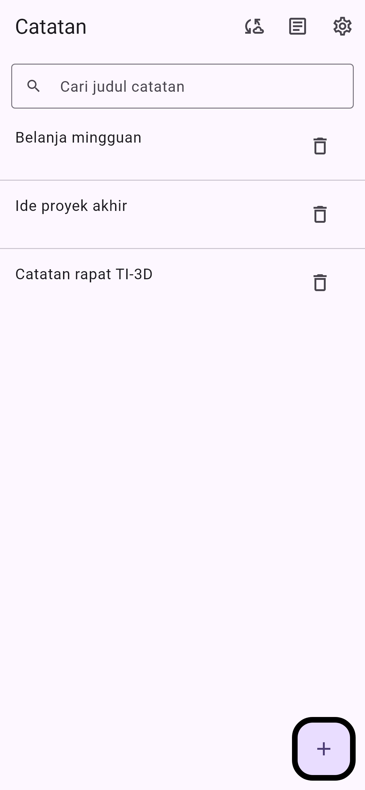 | 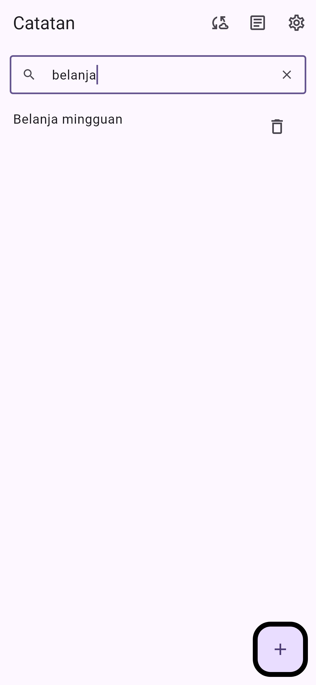 | 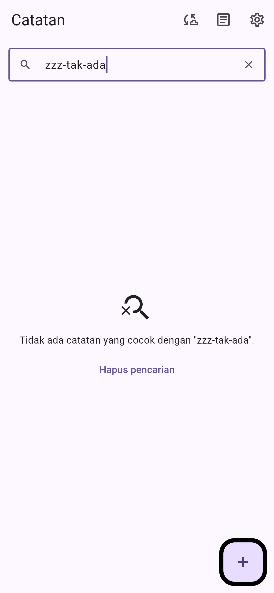 |

Perilaku yang dibuktikan test: query kosong menampilkan semua, pencarian
mengabaikan besar/kecil huruf, cocok di tengah kata, spasi tepi diabaikan, query
tak cocok menampilkan empty state, dan tombol hapus memulihkan daftar **sekaligus**
mengosongkan field.

---

## 2. Praktikum 1 — Prompt dan context engineering

### 2.1 Formula 5 slot

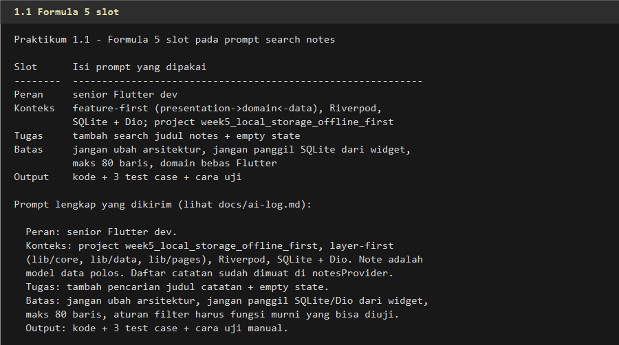

```text
Peran: senior Flutter dev.
Konteks: project week5_local_storage_offline_first, layer-first
(lib/core, lib/data, lib/pages), Riverpod, SQLite + Dio. Model Note adalah
model data polos (id, title, body, updatedAt, dirty). Daftar catatan sudah
dimuat lewat notesProvider.
Tugas: tambah pencarian judul catatan + empty state.
Batas: jangan ubah arsitektur, jangan panggil SQLite/Dio dari widget,
maks 80 baris, aturan filter harus fungsi murni yang bisa diuji.
Output: kode + 3 test case + cara uji manual.
```

### 2.2 Buruk vs baik

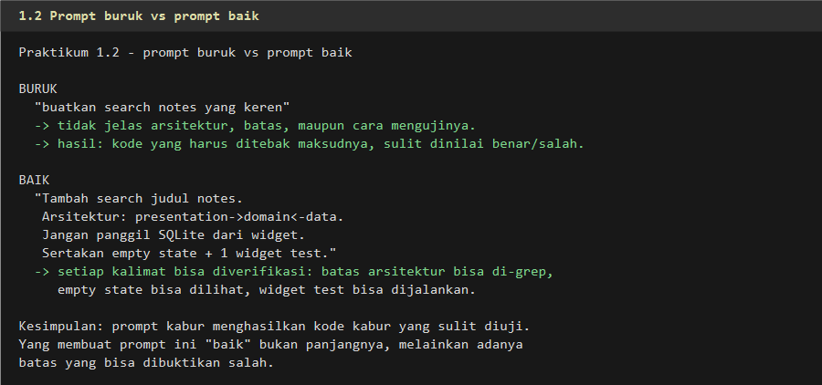

```text
BURUK : "buatkan search notes yang keren"
BAIK  : "Tambah search judul notes.
         Arsitektur: presentation->domain<-data.
         Jangan panggil SQLite dari widget.
         Sertakan empty state + 1 widget test."
```

Prompt kabur menghasilkan kode kabur yang sulit diuji. Yang membuat prompt baik
bukan panjangnya, melainkan adanya **batas yang bisa dibuktikan salah** —
"jangan panggil SQLite dari widget" bisa diperiksa dengan `grep`.

### 2.3 Konteks, bukan secret

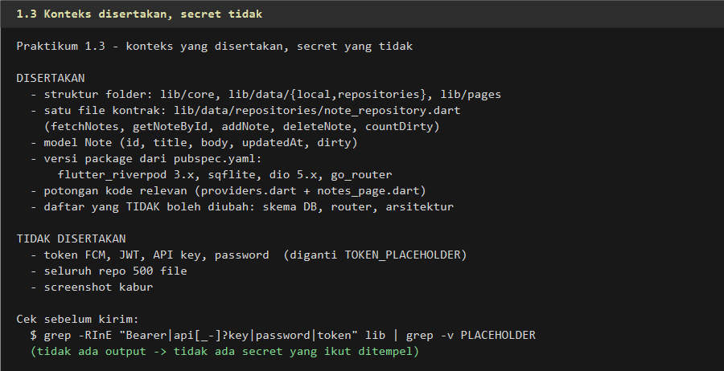

| Disertakan | Tidak disertakan |
|---|---|
| Struktur folder (`lib/core`, `lib/data`, `lib/pages`) | Token FCM / JWT / API key / password (→ `TOKEN_PLACEHOLDER`) |
| Kontrak repository (`fetchNotes`, `addNote`, `deleteNote`, …) | Seluruh repo 500+ file |
| Model `Note` + versi package dari `pubspec.yaml` | Screenshot kabur |
| Potongan kode relevan + daftar yang tidak boleh diubah | — |

Pemeriksaan sebelum mengirim:

```bash
grep -RInE "Bearer|api[_-]?key|password|token" lib
# (tidak ada output → tidak ada secret yang ikut ditempel)
```

---

## 3. Praktikum 2 — Generate dan verifikasi search

### 3.1 Output awal AI dan halusinasinya

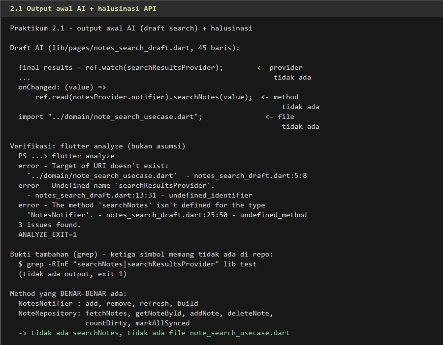

AI mengirim satu widget utuh yang memakai tiga simbol **yang tidak ada** di repo:

| Simbol | Klaim AI | Kenyataan |
|---|---|---|
| `../domain/note_search_usecase.dart` | file use case | tidak ada; week5 tidak punya `lib/domain` |
| `searchResultsProvider` | provider hasil filter | tidak ada |
| `NotesNotifier.searchNotes()` | method pencarian | tidak ada (hanya `add`, `remove`) |

```
$ flutter analyze
error - Target of URI doesn't exist: '../domain/note_search_usecase.dart'
error - Undefined name 'searchResultsProvider'.
error - The method 'searchNotes' isn't defined for the type 'NotesNotifier'.
3 issues found.                                   ANALYZE_EXIT=1
```

```
$ grep -RInE "searchNotes|searchResultsProvider" lib test
(tidak ada output, exit 1)
```

### 3.2 Verifikasi 6 langkah

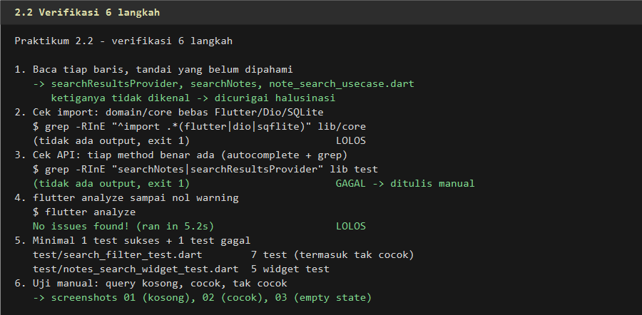

| # | Langkah | Hasil |
|---|---|---|
| 1 | Baca tiap baris, tandai yang belum dipahami | 3 simbol asing → dicurigai |
| 2 | Cek import: core bebas Flutter/Dio/SQLite | `grep` kosong → **lolos** |
| 3 | Cek API: tiap method benar ada | `grep` kosong → **gagal** → ditulis manual |
| 4 | `flutter analyze` sampai nol warning | No issues found! |
| 5 | Minimal 1 test sukses + 1 test gagal | 7 test filter (termasuk tak cocok) + 5 widget test |
| 6 | Uji manual: kosong, cocok, tak cocok | `01`, `02`, `03` |

### 3.3 Bukti test merah

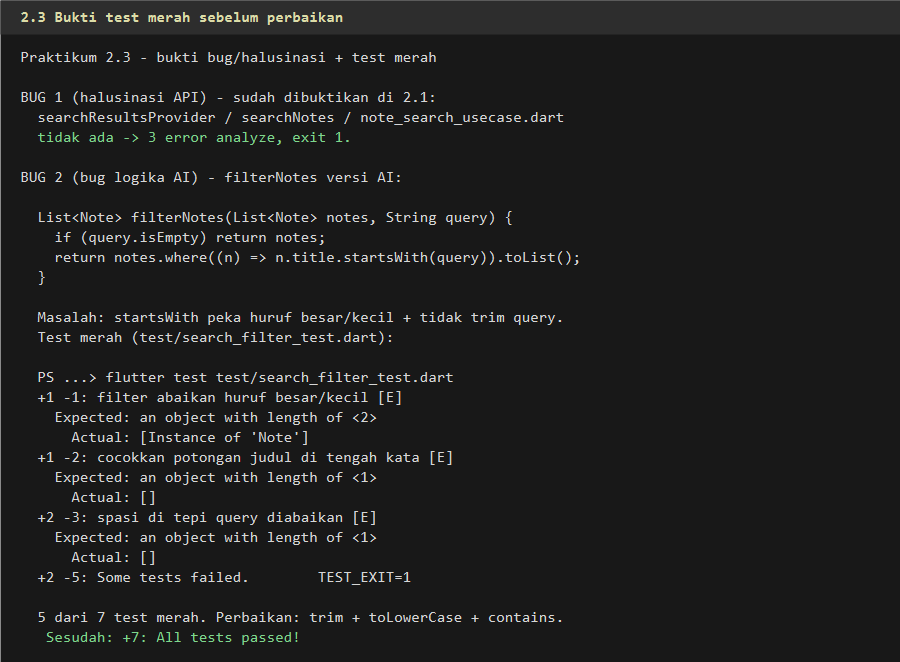

Dua bug dibuktikan dengan test, bukan opini:

**Bug logika** — `startsWith` peka huruf besar/kecil dan tidak `trim`:

```
$ flutter test test/search_filter_test.dart
+1 -1: filter abaikan huruf besar/kecil [E]
  Expected: an object with length of <2>
    Actual: [Instance of 'Note']
+1 -2: cocokkan potongan judul di tengah kata [E]
  Expected: an object with length of <1>
    Actual: []
+2 -5: Some tests failed.              TEST_EXIT=1
```

**Bug state** — field tidak ikut kosong saat tombol **Hapus pencarian** ditekan:

```
+4 -1: hapus pencarian juga mengosongkan isi field [E]
  Expected: empty
    Actual: 'zzz-tak-ada'              TEST_EXIT=1
```

Keduanya diperbaiki kecil (8 baris filter, 6 baris `didUpdateWidget`), lalu
`flutter test` → **+20 All tests passed!**

---

## 4. Praktikum 3 — Debug dan refactor

### 4.1 Debug dengan test merah

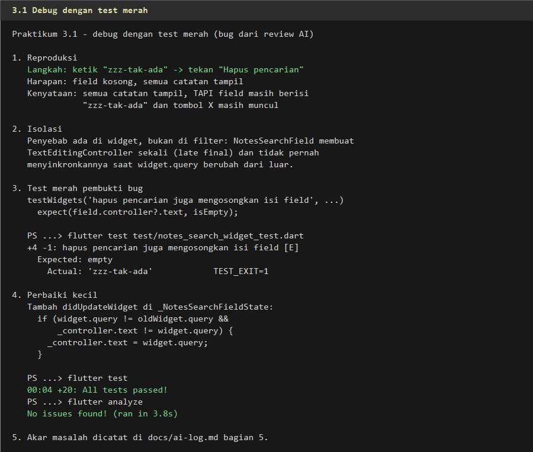

Alur yang dipakai (bukan "fix dong" tanpa bukti):

1. **Reproduksi** — ketik `zzz-tak-ada` → tekan **Hapus pencarian**; daftar
   pulih tetapi field masih berisi teks lama.
2. **Isolasi** — penyebab di widget, bukan filter: `TextEditingController`
   dibuat `late final` dan tidak disinkronkan saat `widget.query` berubah.
3. **Test merah** — `expect(field.controller?.text, isEmpty)` → `Actual: 'zzz-tak-ada'`.
4. **Perbaiki kecil** — `didUpdateWidget` menyamakan isi controller dengan
   `widget.query`; `flutter test` → 20 hijau, `flutter analyze` bersih.
5. **Catat akar masalah** — `docs/ai-log.md` bagian 5.2.

### 4.2 Refactor ke layer yang benar

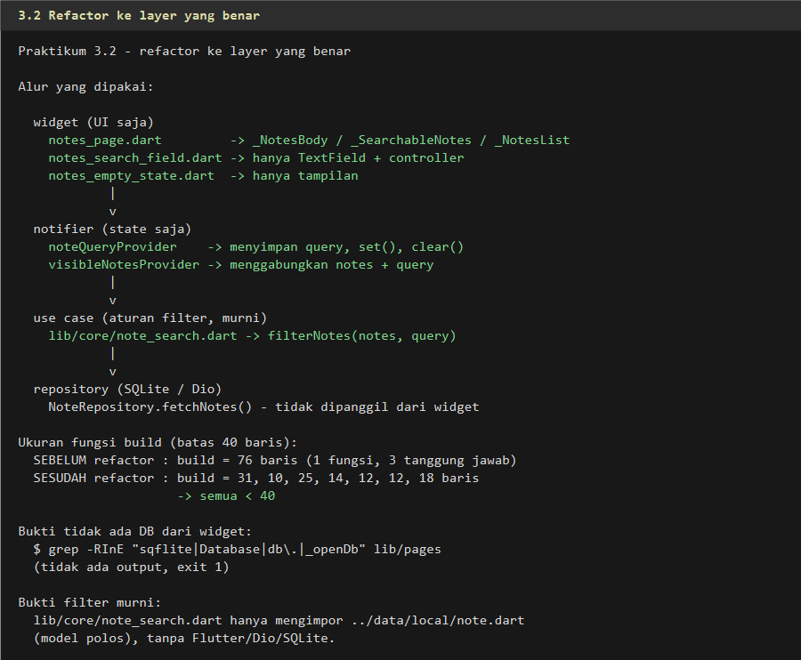

```
widget (UI saja)
  notes_page.dart         -> _NotesBody / _SearchableNotes / _NotesList
  notes_search_field.dart -> hanya TextField + controller
  notes_empty_state.dart  -> hanya tampilan
        |
        v
notifier (state saja)
  noteQueryProvider    -> menyimpan query, set(), clear()
  visibleNotesProvider -> menggabungkan notes + query
        |
        v
use case (aturan filter, murni)
  lib/core/note_search.dart -> filterNotes(notes, query)
        |
        v
repository (SQLite / Dio)
  NoteRepository.fetchNotes() - tidak dipanggil dari widget
```

| Ukuran `build` | Baris |
|---|---|
| Sebelum refactor | **76** (satu fungsi, tiga tanggung jawab) |
| Sesudah refactor | 31 / 10 / 25 / 14 / 12 / 12 / 18 → semua **< 40** |

```
$ grep -RInE "sqflite|Database|db\.|_openDb" lib/pages
(tidak ada output, exit 1)
```

### 4.3 Verifikasi akhir

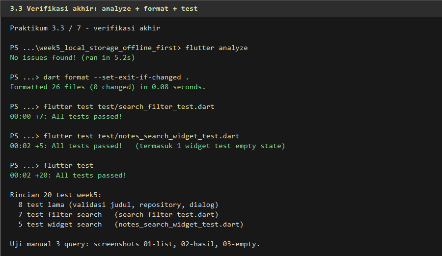

```
$ flutter analyze
No issues found! (ran in 5.2s)

$ dart format --set-exit-if-changed .
Formatted 26 files (0 changed) in 0.08 seconds.

$ flutter test test/search_filter_test.dart
00:00 +7: All tests passed!

$ flutter test test/notes_search_widget_test.dart
00:02 +5: All tests passed!        (termasuk 1 widget test empty state)

$ flutter test
00:02 +20: All tests passed!
```

Rincian 20 test: **8** test lama (validasi judul) + **7** filter + **5** widget
search.

---

## 5. AI Challenge — review kode search

### 5.1 Prompt review dan 3 temuan

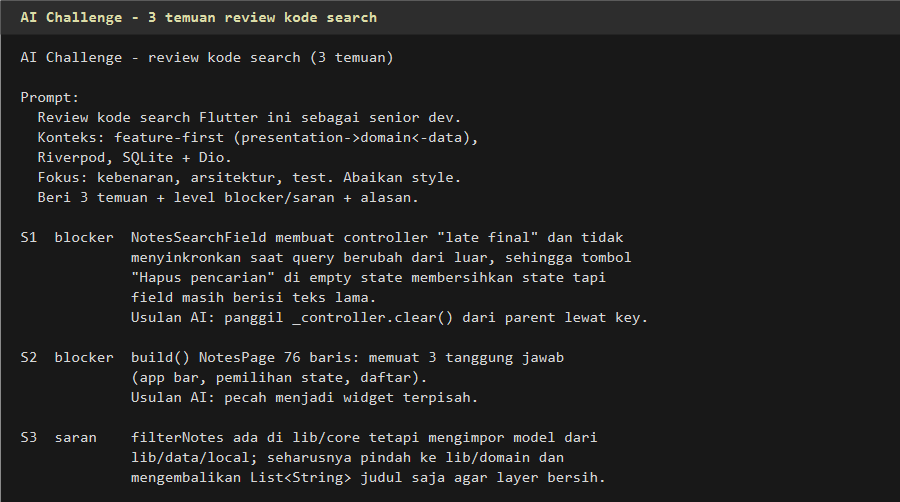

```text
Review kode search Flutter ini sebagai senior dev.
Konteks: feature-first (presentation->domain<-data), Riverpod, SQLite + Dio.
Fokus: kebenaran, arsitektur, test. Abaikan style.
Beri 3 temuan + level blocker/saran + alasan.
```

| ID | Level | Temuan | Usulan AI |
|---|---|---|---|
| S1 | blocker | Field pencarian tidak tersinkron saat query berubah dari luar | Panggil `_controller.clear()` dari parent lewat `GlobalKey` |
| S2 | blocker | `build()` `NotesPage` 76 baris, tiga tanggung jawab | Pecah menjadi widget terpisah |
| S3 | saran | `filterNotes` di `lib/core` mengimpor model dari `lib/data/local`; seharusnya pindah ke `lib/domain` dan mengembalikan `List<String>` | Pindahkan + ubah tipe kembalian |

### 5.2 Bukti dan keputusan

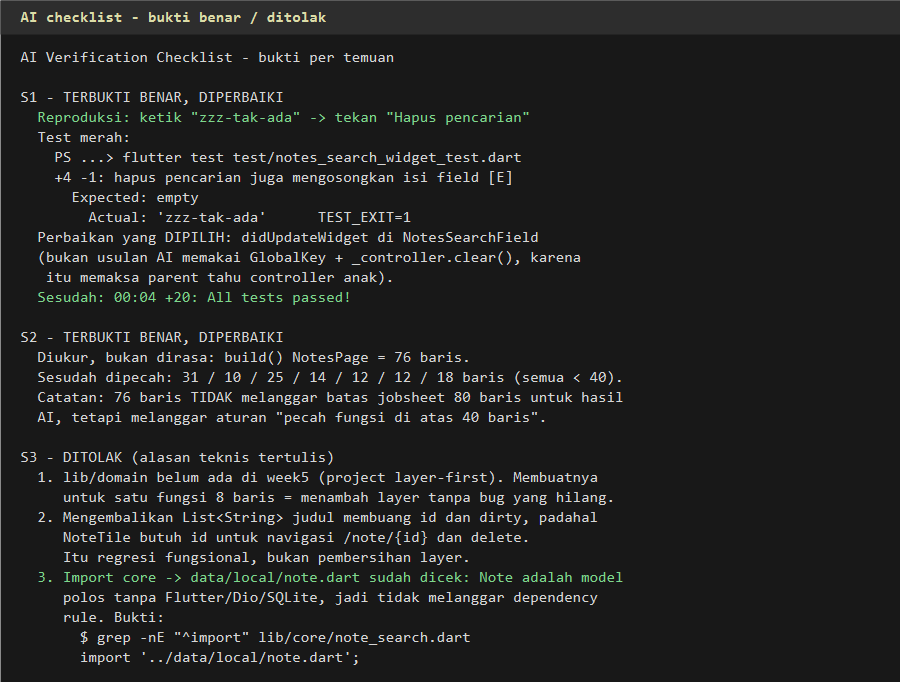

| ID | Keputusan | Alasan | Bukti |
|---|---|---|---|
| **S1** | **Terima + refactor** | Bug nyata, tapi fix dipilih `didUpdateWidget` (bukan `GlobalKey`, karena itu memaksa parent tahu controller anak) | Test merah `Expected: empty` / `Actual: 'zzz-tak-ada'` → 20 hijau |
| **S2** | **Terima + refactor** | Diukur 76 baris; dipecah jadi 31/10/25/14/12/12/18 | Hitung baris + `flutter analyze` bersih |
| **S3** | **Tolak** | (a) `lib/domain` belum ada — menambah layer untuk 8 baris; (b) `List<String>` membuang `id` → navigasi `/note/{id}` dan tombol hapus rusak; (c) `Note` model polos, jadi import `core → data/local` tidak melanggar dependency rule | `grep -nE "^import" lib/core/note_search.dart` → hanya `note.dart` |

### 5.3 Keputusan tiap file hasil AI

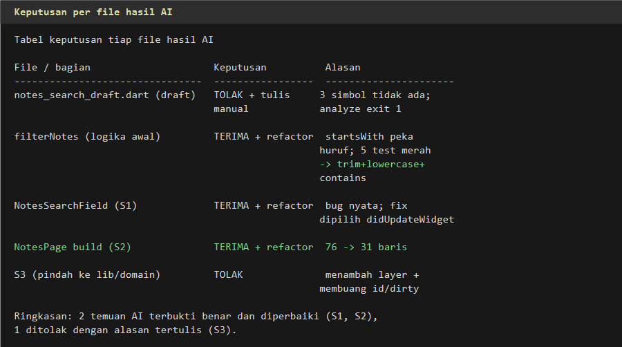

| File / bagian | Keputusan |
|---|---|
| `notes_search_draft.dart` | **Tolak + tulis manual** (3 simbol tidak ada, analyze exit 1) |
| `filterNotes` logika awal | **Terima + refactor** (`startsWith` → `trim`+`toLowerCase`+`contains`) |
| `NotesSearchField` (S1) | **Terima + refactor** (`didUpdateWidget`) |
| `NotesPage.build` (S2) | **Terima + refactor** (76 → 31 baris) |
| S3 (`lib/domain`) | **Tolak** (menambah layer + membuang `id`/`dirty`) |

Syarat jobsheet terpenuhi: **2 temuan terbukti benar dan diperbaiki** (S1, S2)
dan **1 ditolak dengan alasan teknis tertulis** (S3).

---

## 6. Stack teknologi

- Flutter 3.47.2 / Dart 3.13.2, Material 3
- **flutter_riverpod** 3 — state management (`noteQueryProvider`,
  `visibleNotesProvider`)
- **sqflite** — penyimpanan catatan (tidak diakses dari widget)
- **dio** 5 — HTTP client (tidak dipakai fitur ini)
- **go_router** — navigasi `/note/{id}`
- **flutter_test** — unit test filter + widget test pencarian

---

## 7. Cara menjalankan

```bash
git clone https://github.com/BagasArdiansaPutra/244107020166-mobile-course.git
cd 244107020166-mobile-course
git checkout main

cd week5_local_storage_offline_first
flutter pub get
flutter run
```

Uji manual pencarian:

1. Tambahkan 2–3 catatan (mis. `Belanja mingguan`, `Ide proyek akhir`).
2. Ketik `belanja` → hanya catatan yang cocok tampil.
3. Ketik `zzz-tak-ada` → muncul empty state + tombol **Hapus pencarian**.
4. Tekan **Hapus pencarian** → daftar pulih dan field kosong.
5. Kosongkan query → semua catatan tampil.

Pemeriksaan mesin:

```bash
flutter analyze
dart format --output=none --set-exit-if-changed .
flutter test test/search_filter_test.dart
flutter test test/notes_search_widget_test.dart
flutter test
```

---

## 8. Hasil yang dicapai

| Metrik | Sebelum | Sesudah |
|---|---|---|
| Fitur pencarian judul | tidak ada | ada + empty state |
| Test week5 | 8 | **20** |
| `flutter analyze` | 0 issue | 0 issue |
| `dart format` | 0 changed | 0 changed |
| `build()` terpanjang | 76 baris | **31** baris |
| Panggilan SQLite dari widget | — | **0** (`grep` kosong) |
| Halusinasi AI tertangkap | — | 3 simbol (analyze exit 1) |
| Bug AI tertangkap test | — | 2 (filter + state field) |

---

## 9. Checklist verifikasi mandiri

| Syarat | Status | Bukti |
|---|---|---|
| Prompt 5 slot + konteks di `docs/ai-log.md` | Terpenuhi | `docs/ai-log.md` bagian 1–2, `04`–`06` |
| `flutter analyze` bersih | Terpenuhi | `No issues found!` |
| `flutter test` hijau | Terpenuhi | **20** test (`+20 All tests passed!`) |
| 1 temuan AI dibuktikan benar + 1 ditolak beralasan | Terpenuhi | S1/S2 benar; S3 ditolak (`14`) |
| Mampu menjelaskan tanpa membuka AI | Terpenuhi | Bagian 10 |

---

## 10. Refleksi

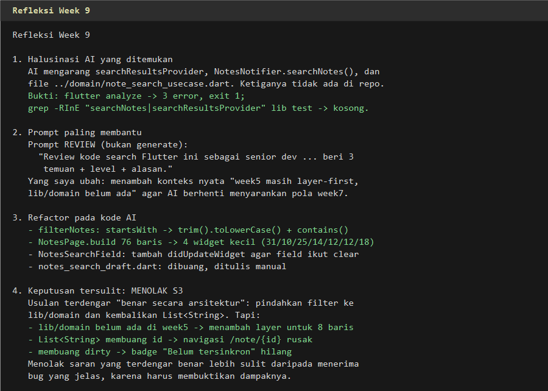

**1. Satu halusinasi AI apa yang Anda temukan dan bagaimana membuktikannya?**

AI mengarang **tiga** simbol sekaligus: file `../domain/note_search_usecase.dart`,
provider `searchResultsProvider`, dan method `NotesNotifier.searchNotes()`.
Ketiganya terlihat wajar — nama file mengikuti konvensi clean architecture, nama
provider mengikuti gaya Riverpod di repo, dan `searchNotes` terdengar seperti
pasangan alami `add`/`remove`.

Cara membuktikannya dua lapis:

1. **`flutter analyze`** — tiga error dengan lokasi persis (`uri_does_not_exist`,
   `undefined_identifier`, `undefined_method`), exit code `1`.
2. **`grep`** — `grep -RInE "searchNotes|searchResultsProvider" lib test`
   tidak menghasilkan apa pun, membuktikan simbol itu tidak pernah ada di repo,
   bukan sekadar salah tempat.

Yang membuat halusinasi ini berbahaya: kodenya **kompilasi-able secara kasat
mata**. Tanpa menjalankan analyzer, draft itu terlihat seperti solusi lengkap.
Karena itu aturan saya sekarang: output AI tidak dianggap ada sampai
`flutter analyze` hijau.

**2. Prompt mana yang paling membantu dan apa yang Anda ubah?**

Yang paling membantu bukan prompt generate, melainkan prompt **review**:

```text
Review kode search Flutter ini sebagai senior dev.
Konteks: feature-first (presentation->domain<-data), Riverpod, SQLite + Dio.
Fokus: kebenaran, arsitektur, test. Abaikan style.
Beri 3 temuan + level blocker/saran + alasan.
```

Yang saya ubah: menambahkan **konteks nyata** bahwa week5 masih layer-first dan
`lib/domain` belum ada. Tanpa kalimat itu, AI berulang kali menyarankan pola
week7 (`Either`, use case layer) yang tidak berlaku — persis seperti S3. Satu
kalimat konteks memangkas saran yang tidak relevan dan membuat diskusi fokus ke
bug yang benar-benar ada (S1).

Pada prompt generate, yang paling berpengaruh adalah slot **Batas**:
"jangan panggil SQLite dari widget" dan "filter harus fungsi murni". Keduanya
bisa diverifikasi dengan `grep`, sehingga saya tidak perlu menebak apakah AI
patuh.

**3. Satu refactor apa yang Anda lakukan pada kode AI?**

Memecah `build()` `NotesPage` yang 76 baris menjadi empat widget dengan satu
tanggung jawab masing-masing (`_NotesBody`, `_SearchableNotes`, `_NotesList`,
plus pemecahan `DirtyBadge`/`_EmptyView`/`_ErrorView`). Hasilnya `build()`
terpanjang kini 31 baris.

Dampaknya bukan sekadar angka: setelah dipecah, **filter tidak mungkin lagi
dipanggil dari tempat yang salah**, karena satu-satunya jalur adalah
`visibleNotesProvider → filterNotes`. Sebelumnya, logika pencarian, pemilihan
state kosong, dan navigasi bercampur dalam satu fungsi — persis kondisi yang
membuat bug S1 (field tidak tersinkron) sulit dilihat.

Refactor lain yang lebih kecil tapi berdampak: `filterNotes` dari
`startsWith` menjadi `trim().toLowerCase().contains()`. Lima test merah
sebelumnya langsung hijau, dan aturan filter sekarang bisa diuji tanpa widget
sama sekali.

**4. Keputusan terima/tolak mana yang paling sulit?**

Menolak **S3**. S1 dan S2 mudah: keduanya punya bukti keras (test merah,
hitungan baris). S3 berbeda — usulannya **terdengar benar secara arsitektur**:
"pindahkan filter ke `lib/domain`, jangan biarkan `core` mengimpor `data`".
Menolaknya terasa seperti menolak praktik terbaik.

Alasan penolakan baru jelas setelah saya telusuri dampaknya:

1. `lib/domain` belum ada di week5. Membuatnya untuk satu fungsi 8 baris berarti
   menambah layer tanpa satu bug pun yang hilang — persis kesalahan yang sama
   dengan A3 di Minggu 8.
2. Mengembalikan `List<String>` membuang `id` dan `dirty`. `NoteTile` butuh `id`
   untuk `context.push('/note/${note.id}')` dan tombol hapus butuh `id`;
   badge "Belum tersinkron" butuh `dirty`. Jadi "pembersihan layer" itu akan
   **merusak tiga fitur**.
3. Import `core → data/local/note.dart` tidak melanggar dependency rule, karena
   `Note` adalah model polos tanpa Flutter/Dio/SQLite. Aturan yang sebenarnya
   dilanggar bukan "core tidak boleh impor data", melainkan "domain tidak boleh
   impor framework" — dan itu tidak terjadi.

Pelajaran: saran arsitektur harus diuji dengan **dampak fungsional**, bukan
diterima karena terdengar rapi. Menolak saran yang benar-secara-umum tapi salah
untuk konteks ini lebih sulit — dan lebih penting — daripada menerima bug yang
jelas.

---

## 11. Struktur folder laporan

```
09-week-9-ai-assisted-development/
├── README.md                          # laporan ini
├── docs/
│   └── ai-log.md                      # prompt, output awal, halusinasi,
│                                      # test merah, tabel keputusan, hasil
└── screenshots/
    ├── 01-search-list.png             # daftar + kolom cari
    ├── 02-search-hasil.png            # hasil pencarian "belanja"
    ├── 03-search-empty.png            # empty state + tombol hapus
    ├── 04-prompt-5-slot.png           # formula 5 slot
    ├── 05-prompt-baik-buruk.png       # prompt buruk vs baik
    ├── 06-konteks-secret.png          # konteks disertakan vs secret
    ├── 07-ai-halusinasi.png           # 3 error analyze + grep kosong
    ├── 08-verifikasi-6-langkah.png    # checklist 6 langkah
    ├── 09-test-merah.png              # test merah sebelum perbaikan
    ├── 10-debug-test-merah.png        # alur debug 5 langkah
    ├── 11-refactor-layer.png          # alur widget -> notifier -> use case
    ├── 12-verifikasi-akhir.png        # analyze + format + test
    ├── 13-ai-review-temuan.png        # 3 temuan review AI
    ├── 14-ai-bukti-keputusan.png      # bukti benar / alasan tolak
    ├── 15-ai-per-file.png             # keputusan per file
    └── 16-refleksi.png                # jawaban refleksi
```

---

## 12. Berkas kode yang berubah

| File | Status | Isi |
|---|---|---|
| `lib/core/note_search.dart` | baru | `filterNotes` fungsi murni (14 baris) |
| `lib/pages/widgets/notes_search_field.dart` | baru | kolom cari + `didUpdateWidget` |
| `lib/pages/widgets/notes_empty_state.dart` | baru | empty state + tombol hapus |
| `lib/pages/notes_page.dart` | diubah | dipecah jadi 4 widget, `build` 76 → 31 baris |
| `lib/data/providers.dart` | diubah | `noteQueryProvider` + `visibleNotesProvider` |
| `test/search_filter_test.dart` | baru | 7 unit test filter |
| `test/notes_search_widget_test.dart` | baru | 5 widget test pencarian |
